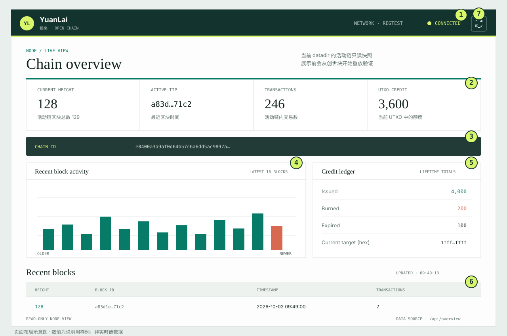

# YuanLai 节点使用与操作指南

> **旧版路线 / 暂缓扩展**：本文只适用于当前 PoW、Credit 和课程交易实现，不是新版文件指纹登记产品的操作说明。新版尚未实现；请先阅读[新版产品方案](new-product-proposal.md)和[项目跟踪计划](project-tracking.md)。本文保留供旧版本地测试与维护使用。

> **实验软件提示**：YuanLai 当前处于 P5 pre-alpha。本文适用于本地开发、regtest 演练和受控测试环境，不代表节点已适合公开网络或真实版权存证。P2P 尚未经过公网级压力测试和安全审计；不要把 P2P 或 HTTP API 直接暴露给不可信网络。

## 1. 组件与准备

- `yuanlai-node` 负责保存并验证区块链、挖矿、P2P 同步、交易 relay 和只读 API。
- `yuanlai-cli` 负责扫描课程目录、构造并签名身份/课程交易，以及生成作者验证交易。
- `--network` 可选 `devnet` 或 `regtest`；省略时默认为 `devnet`。本文演练命令使用 `regtest`，不要把不同网络的数据目录混用。
- 建议总是显式设置 `--datadir`。省略时使用 `$HOME/.yuanlai/<network>`。
- 从仓库根目录编译：

```sh
cargo build --release -p yuanlai-node -p yuanlai-cli --locked
```

多数命令可用 `cargo run --release -p <package> -- ...` 代替直接运行编译产物。

## 2. 参数速查

| 参数 | 用途 |
|---|---|
| `--network devnet|regtest` | 选择链；省略时为 `devnet` |
| `--datadir PATH` | 区块数据、待处理 mempool 和 peer 配置目录 |
| `--mine` | 在本地挖矿；不与 `--listen` 或 `--connect` 同时使用 |
| `--beneficiary HEX` | 32 字节公钥的 64 位十六进制文本；挖矿时指定收款方，relay listener 时用于候选区块上下文的交易校验 |
| `--blocks N` | 本次最多挖 N 个区块；挖矿时省略会持续运行 |
| `--tx-file PATH` | 读取一个规范二进制交易文件；可重复指定。文件必须恰好包含一笔交易 |
| `--listen ADDR` | 接收入站 P2P 连接并提供本机活动链；可选配合 `--beneficiary` 启用交易 relay |
| `--connect ADDR` | 连接静态 peer；可重复指定，按顺序尝试 |
| `--stay-connected` | 长期运行并周期性重连/同步，使用 datadir 中保存的 peer 地址 |
| `--api-listen ADDR` | 启动只读 HTTP 页面和 API；建议只绑定 loopback |

`--mine`、`--listen`、`--connect` 是不同运行模式。挖矿不能与 P2P 网络模式并行；API 可以与持续运行的挖矿、listener 或 `--stay-connected` 一起启动。首次使用 `--stay-connected` 时，至少要提供 `--connect` 地址，或预先准备 `peers.txt`。

## 3. Datadir 与备份

节点会在 datadir 中维护：

- `blocks.dat`：区块记录。节点启动和 API 查询会验证链数据；不要手工编辑。
- `mempool.dat`：已接纳但尚未上链的交易。启动 listener 或矿工时会按当前活动链重验并清理失效交易。
- `peers.txt`：仅在 `--stay-connected` 模式使用的静态 peer 地址，每行一个。CLI 的 `--connect` 地址会与已有内容合并、去重并原子保存；最多 64 个地址，单地址最多 512 字节。

`--connect` 的 one-shot 模式不会修改 `peers.txt`。peer 文件只在进程启动时载入；运行期间不要编辑，改完后重启节点。

私钥、身份秘密和 salt 不会由节点自动生成或备份。备份 datadir 时也要单独安全备份密钥材料。复制 datadir 前先停止正在写入的节点，以免拿到不一致快照。

## 4. 本地挖矿

先准备与 beneficiary 公钥对应的密钥，并把公钥编码成 64 位十六进制文本。节点只接收公钥，不提供密钥生成或托管功能。

有限挖矿示例：

```sh
cargo run --release -p yuanlai-node -- \
  --network regtest \
  --datadir ./node-regtest \
  --mine \
  --beneficiary <64位公钥十六进制> \
  --blocks 10
```

省略 `--blocks 10` 会持续挖矿，按 `Ctrl+C` 停止。命令可重复接受 `--tx-file`，例如：

```sh
cargo run --release -p yuanlai-node -- \
  --network regtest \
  --datadir ./node-regtest \
  --mine \
  --beneficiary <64位公钥十六进制> \
  --blocks 1 \
  --tx-file ./transactions/tx-001.bin
```

矿工会先加载并验证 mempool，再加入本次 `--tx-file`，然后构造区块。若交易无效、余额不足或不满足当前链状态，命令会报错，不会将其作为有效交易挖入。

## 5. P2P 同步与长期 peer

### 启动链服务端

```sh
cargo run --release -p yuanlai-node -- \
  --network regtest \
  --datadir ./node-a \
  --listen 127.0.0.1:18444
```

listener 提供 datadir 当前已经验证的活动链，不会自行向其他节点同步，也不会在此模式下挖矿。只有需要接收交易时才加 `--beneficiary`，见下一节。对外监听地址、端口和防火墙需要由部署者自行配置；不要在不可信网络开放。

### 一次性同步

另开终端运行：

```sh
cargo run --release -p yuanlai-node -- \
  --network regtest \
  --datadir ./node-b \
  --connect 127.0.0.1:18444
```

节点会握手、验证 header 与区块，并原子切换到累计工作更高的有效链，然后退出。可重复指定 `--connect`，多个 peer 按顺序尝试：至少一个同步成功，命令即成功。若提供 `--tx-file`，交易会在同步后提交给每个成功连接的 peer，并等待交易 ID 匹配的 ACK。

### 周期性重连

首次启动时 seed 静态 peer：

```sh
cargo run --release -p yuanlai-node -- \
  --network regtest \
  --datadir ./node-b \
  --connect 127.0.0.1:18444 \
  --connect 192.0.2.10:18444 \
  --stay-connected
```

地址会保存到 `./node-b/peers.txt`。以后重启可省略 `--connect`：

```sh
cargo run --release -p yuanlai-node -- \
  --network regtest \
  --datadir ./node-b \
  --stay-connected
```

`--stay-connected` 为每个 peer 独立记录连续失败数、下次尝试时间和最近成功时间。连接失败按 1、2、4 秒递增退避，最高 30 秒；某 peer 同步成功后约 30 秒再尝试。它是**周期性短连接**，不是常驻 TCP 会话；peer 仍按顺序处理，不做并行同步或自动发现。进程保持前台运行，可用 `Ctrl+C` 停止。

不要把一次性交易提交配置成长期重试：`--stay-connected` 配合 `--tx-file` 会在每次成功同步时再次提交同一交易文件。重复交易会被 ACK，但不会再次转发；要提交一次请使用上一节不带 `--stay-connected` 的 `--connect` 命令。

## 6. 交易 relay

relay listener 必须选择 beneficiary，以确定 mempool 交易校验所用的候选区块上下文：

```sh
cargo run --release -p yuanlai-node -- \
  --network regtest \
  --datadir ./relay-node \
  --listen 127.0.0.1:18444 \
  --beneficiary <64位公钥十六进制>
```

client 同步后提交 CLI 生成的交易文件：

```sh
cargo run --release -p yuanlai-node -- \
  --network regtest \
  --datadir ./sender-node \
  --connect 127.0.0.1:18444 \
  --tx-file ./transactions/tx-001.bin
```

新交易只有在校验并写入 listener 的 `mempool.dat` 后才会得到 accepted ACK；新接纳交易还会转发给该 listener 上其他已握手的 inbound peers，不会回传给来源连接。重复交易会得到 accepted ACK，但不会再次转发。单 listener 最多接收 8 个连接、每个源 IP 最多 2 个；握手总时限 5 秒，每帧读取总时限 60 秒。

relay 与挖矿不能同时运行。要消费待处理交易，先停止 relay，再对同一 network/datadir 使用原 beneficiary 启动矿工：

```sh
cargo run --release -p yuanlai-node -- \
  --network regtest \
  --datadir ./relay-node \
  --mine \
  --beneficiary <与 relay 相同的公钥十六进制> \
  --blocks 1
```

矿工启动时会重验 mempool；已过期、已被区块消费或不再有效的交易会被丢弃。

## 7. 身份登记与课程存证

`yuanlai-cli` 读取 datadir 中的本地活动链，故 CLI 和 node 必须使用相同的 `--network` 与 `--datadir`。交易文件是 CLI 生成的规范二进制 `.bin`，不要用文本编辑器修改。

### 密钥文件

- `owner.key` 必须是 32 字节 Ed25519 私钥原始字节；macOS/Linux 上限制权限：`chmod 600 ./owner.key`。
- `identity.secret` 和 `identity.salt` 必须是相互独立、均匀随机、规范编码的 32 字节小端 Pallas 基域元素，并限制为所有者可读：`chmod 600 ./identity.secret ./identity.salt`。
- CLI 不负责生成上述密钥/秘密。使用可信的本地密钥管理方式生成和备份；不要把文件提交到 Git、发给 peer 或贴进日志。
- 交易需要该身份对应的可花费 Credit。CLI 会读取当前 datadir 并在构造前检查状态与费用；若没有可用额度，应先在该测试网络取得并等待可花费额度。

### 首次身份登记

在尚未登记该公钥身份时运行：

```sh
cargo run --release -p yuanlai-cli -- identity-register \
  --network regtest \
  --datadir ./node-regtest \
  --identity-secret-file ./identity.secret \
  --salt-file ./identity.salt \
  --key-file ./owner.key \
  --out-dir ./identity-transactions
```

CLI 会打印身份承诺、费用和一条或多条 `submit` 命令。按输出原样逐条执行，让交易进入本地链；之后再构造依赖该身份的课程交易。若已有符合规范的 commitment，也可使用 `--commitment <64位十六进制>` 替代两个 witness 文件。

### 扫描与登记课程

先扫描目录；该操作只生成清单，不提交区块链：

```sh
cargo run --release -p yuanlai-cli -- scan ./my-course
```

记下输出的 root 与 estimated cost。然后生成课程登记交易：

```sh
cargo run --release -p yuanlai-cli -- register \
  --network regtest \
  --datadir ./node-regtest \
  --course-dir ./my-course \
  --title '课程标题' \
  --version 1.0 \
  --key-file ./owner.key \
  --out-dir ./course-transactions
```

命令会打印 course root、锁定额度和按组排列的 `submit` 命令。按输出顺序逐组执行；不要重排或并行提交，因为后续交易依赖之前的链上状态。文件内容留在本机，链上登记的是协议定义的路径、大小、内容哈希及相关元数据。

登记新版本时使用完整文件快照，并添加最新父版本 root：

```sh
cargo run --release -p yuanlai-cli -- register \
  --network regtest \
  --datadir ./node-regtest \
  --course-dir ./my-course-v2 \
  --title '课程标题' \
  --version 2.0 \
  --parent-root <最新版本的64位十六进制root> \
  --key-file ./owner.key \
  --out-dir ./course-v2-transactions
```

费用按相对父版本新增或变化的内容计算；目录仍需包含完整快照。

### 作者验证

只有在验证方提供 challenge 后才生成验证交易；不要自行编造或重复使用 challenge：

```sh
cargo run --release -p yuanlai-cli -- author-verify \
  --network regtest \
  --datadir ./node-regtest \
  --course-root <课程root的64位十六进制哈希> \
  --challenge <验证方提供的64位十六进制challenge> \
  --identity-secret-file ./identity.secret \
  --salt-file ./identity.salt \
  --key-file ./owner.key \
  --out-dir ./author-verifications
```

CLI 会生成 Halo2 proof 和签名交易文件并打印提交命令。验证交易会消耗 Credit；具体成本以 CLI 输出为准。

## 8. 只读 Dashboard 与 API

独立查看某 datadir：

```sh
cargo run --release -p yuanlai-node -- \
  --network regtest \
  --datadir ./node-regtest \
  --api-listen 127.0.0.1:18445
```

浏览器打开 `http://127.0.0.1:18445/`；JSON 快照位于 `http://127.0.0.1:18445/api/overview`。若与 `--listen`、`--mine` 或 `--stay-connected` 一起运行，API 会在独立线程提供服务。

### 页面一：链状态 Dashboard

当前 Web 服务只有一个 HTML 页面 `/`，没有单独的钱包、设置或交易提交页面。Dashboard 只读展示所选 datadir 的活动链；挖矿、同步、登记课程等操作仍需在终端运行本指南前面的 node/CLI 命令。



图中数字为说明用样例，不是当前节点实时值。区域说明：

| 编号 | 页面区域 | 功能与使用方法 |
|---|---|---|
| 1 | 顶栏状态 | 显示品牌、当前网络和数据连接状态。`CONNECTED` 表示 Dashboard 成功读取 API，不表示 P2P 已连接 peer。右侧刷新按钮可立即重新读取。 |
| 2 | 链摘要 | `Current height` 是活动链 tip 高度；`Active tip` 是 tip 区块 ID 的缩略显示；`Transactions` 是活动链交易总数；`UTXO Credit` 是当前 UTXO 中未花费额度，不包含课程会话锁定额度。 |
| 3 | Chain ID | 显示网络标识，用于确认正在查看哪条链。比对不同节点时应确认 network 和 Chain ID 相同。 |
| 4 | Recent block activity | 展示最新最多 16 个区块各自的交易数，横轴从旧到新，最右侧红柱表示最新区块。图表是只读统计，不支持点击钻取。 |
| 5 | Credit ledger | 展示累计发行、销毁、过期额度，以及当前难度 target 的十六进制值。`Current target` 是挖矿目标，不是 Credit 余额。 |
| 6 | Recent blocks | 按最新优先列出最多 16 个区块的高度、区块 ID、时间和交易数。区块 ID 在表格中缩略显示，可悬停查看完整 ID；时间按浏览器本地时区显示。 |
| 7 | 手动刷新 | 点击循环箭头立即更新页面；页面也会每 10 秒自动刷新。窗口尺寸变化时会再次读取数据并重绘图表。 |

如果 API 无法访问或区块文件无法验证，顶栏会显示 `UNAVAILABLE`，页面上方会出现错误提示。检查 API 进程、network/datadir 和 `blocks.dat`；文件损坏时应先从可信备份恢复，不要手工修改区块文件。

### 页面二：JSON 数据接口

`GET /api/overview` 是给脚本或其他只读工具使用的数据接口，不是另一个可点击的网页。可以在终端查看格式化 JSON：

```sh
curl -sS http://127.0.0.1:18445/api/overview | python3 -m json.tool
```

主要字段：`network`/`chain_id` 标识网络；`height`、`tip`、`tip_timestamp` 描述 tip；`block_count` 和 `transaction_count` 是活动链计数；`target` 是当前工作目标；`credit` 汇总发行、销毁、过期和当前未花费额度；`recent_blocks` 给出最多 16 个最新区块。大整数以十进制字符串返回，脚本应保留字符串精度，不要先转成浮点数。

该接口不提供写入或交易提交功能。只接受不带请求体的 GET：未知路径返回 `404`，其他方法/带请求体请求返回 `405`；`blocks.dat` 无效或不可读时返回 `503`。完整响应格式见 [API 规格](../spec/08-api.md)。

API 是只读但**没有认证、TLS 或速率限制**；只能绑定 loopback。节点会从创世块开始重放验证 `blocks.dat`，不会把未经验证的链状态作为成功响应返回。

## 9. 常见问题

| 现象 | 检查方法 |
|---|---|
| `connection refused` | 确认服务端进程仍运行、`--listen` 地址/端口正确，且客户端连接的是可达地址 |
| 握手网络不匹配 | 两端使用相同 `--network`；`devnet` 与 `regtest` 不能互连 |
| `--stay-connected` 提示没有 peer | 检查该 datadir 的 `peers.txt`，或首次运行时加一个或多个 `--connect` |
| peer 配置报 UTF-8/空白/超限错误 | 每行一个 `host:port` 或 `[IPv6]:port`；不要加空格、空行；总数不超过 64 |
| `--tx-file` 无效 | 使用 `yuanlai-cli` 生成的 `.bin`；每个文件只能包含一笔完整规范交易，不能有多余尾随字节 |
| CLI 报无可用 Credit 或身份不存在 | 确认 CLI 与 node 的 network/datadir 相同，所需前置交易已上链，密钥对应正确身份 |
| `address already in use` | 选择未占用端口，或停止占用该端口的进程 |
| Dashboard 返回 `503` | 确认 datadir 与网络匹配，且 `blocks.dat` 可读取并能通过完整链验证 |

节点启动时若报告截断未完成的尾记录，会尝试恢复中断写入；完整但无效的区块记录仍会报错，不会被当作有效链静默跳过。

## 10. 操作安全清单

- 开发和演练优先使用 `regtest` 与独立 datadir；不要混用不同网络的目录。
- 不要公开监听未审计的 P2P 服务；若测试 LAN 访问，限制防火墙来源并仅开放需要的端口。
- HTTP API 只绑定 `127.0.0.1`；它无认证和 TLS，不可直接做公网服务。
- `owner.key`、identity secret、salt 使用最小文件权限并独立备份；不要放入版本控制或共享目录。
- `--stay-connected` 保存的是 peer 地址，不是密钥；peer 地址会写入 datadir 的 `peers.txt`。
- 当前没有自动 peer discovery、并行同步或网络挖矿；长期模式仍是顺序短连接。网络实现尚未完成公网安全审计。
